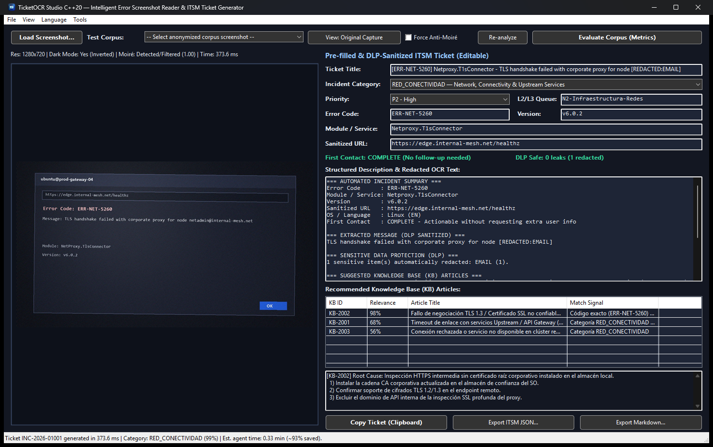
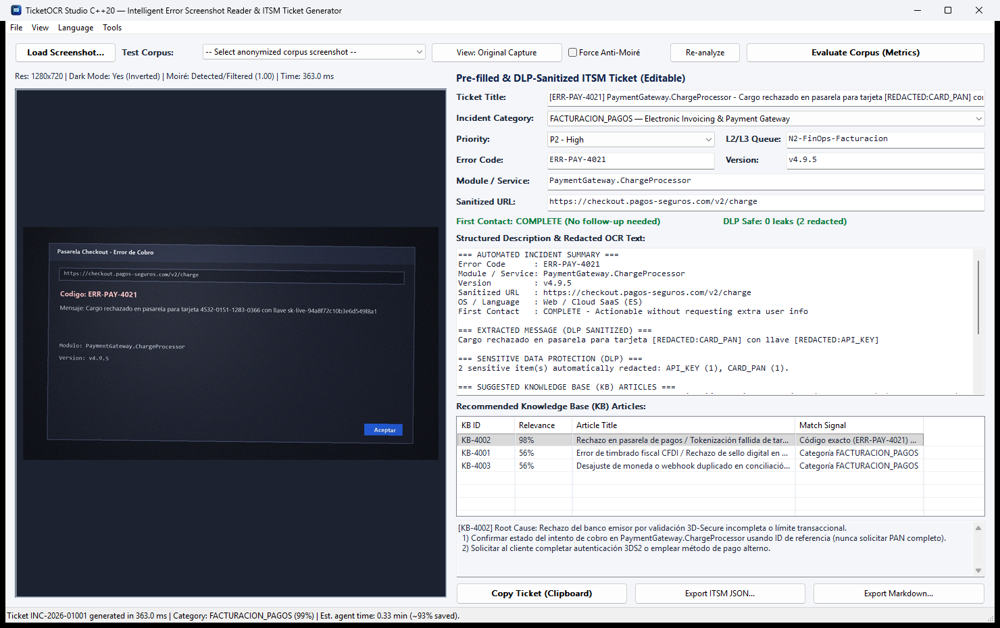

<p align="center">
  
</p>

# TicketOCR Studio (C++20) — Intelligent Error Screenshot Reader & ITSM Ticket Generator

[](https://github.com/stescobedo92/TicketOCR/actions/workflows/release.yml)
[](https://github.com/stescobedo92/TicketOCR/releases)
[](CMakeLists.txt)
[](CMakeLists.txt)
[](reports/benchmark_report.md)

**TicketOCR Studio** is a high-performance native **C++20** desktop application (**Per-Monitor HiDPI Win32/GDI+ GUI**), **CLI automation tool**, and **end-to-end integration & KPI evaluation suite** built to eliminate manual transcription of error screenshots in L1/L2/L3 IT Support & Service Desk operations.

It reads desktop captures and **mobile phone photos taken of monitors (Moiré interference + uneven lighting + Dark Mode)**, extracts structured diagnostic fields (`error_code`, `module_name`, `software_version`, `sanitized_url`, `error_message`), **redacts sensitive credentials and PII with zero leaks**, classifies incidents against support-team categories, recommends **Knowledge Base (KB)** articles, and pre-fills ready-to-export ITSM tickets.

---

## Live Application Preview

### Dark Theme (`View -> Dark Theme`, Default `English` UI)
*Example loaded: Mobile camera photo of a dark-mode Linux terminal/dialog (`S05_LIN_EN_NET_DARK_MOIRE.jpg`) with Moiré fringes and an exposed internal administrator email automatically redacted as `[REDACTED:EMAIL]`.*



### Light Theme (`View -> Light Theme`, Default `English` UI)
*Example loaded: Mobile camera photo of a dark-mode Web SaaS payment error (`S11_WEB_ES_PAY_DARK_MOIRE.jpg`) containing both a credit card PAN and a live secret API key automatically redacted (`[REDACTED:CARD_PAN]`, `[REDACTED:API_KEY]`).*



---

## Download & Run Pre-Built Releases (No Compiler Required)

Every push to `master` or SemVer tag (`vX.Y.Z`) automatically compiles optimized Windows x64 binaries and publishes a portable release package via GitHub Actions:

1. Go to the [**GitHub Releases**](https://github.com/stescobedo92/TicketOCR/releases) page.
2. Download the latest **`TicketOCR-vX.Y.Z-win64.zip`** archive (and optionally verify its checksum against `SHA256SUMS.txt`).
3. Extract the `.zip` folder anywhere on **Windows 10 (1809+) or Windows 11 (x64)**.
4. Double-click **`ticket_ocr_gui.exe`** to launch the graphical studio:
   - **Default Language:** English (`en`), switchable anytime from **`Language -> English (Default) / Español`**.
   - **Theme Switching:** Switch dynamically between Light and Dark mode from **`View -> Light Theme / Dark Theme`**.

---

## 1. Problem Context & Operational Motivation

In enterprise technical support (SaaS platforms, banking, electronic invoicing ERPs, healthcare, and e-commerce), over **65% of user incident reports arrive with nothing more than an attached screenshot or a smartphone photo of a computer monitor**. Support teams face five compounding operational and security bottlenecks:

1. **Inflated Average Handle Time (`5.20 min/ticket` manual baseline):** Support agents spend minutes manually re-typing hexadecimal/alphanumeric error codes (`0x80070005`, `ORA-12170`, `ERR-AUTH-4019`), dotted module names (`PaymentGateway.ChargeProcessor`), build versions (`v4.12.3`), and long endpoint URLs.
2. **Human Transcription Typos:** Visual confusions (`0`/`O`, `1`/`l`/`I`, `5`/`S`) prevent exact correlation against known error codes in the Knowledge Base (KB), misrouting tickets to L2/L3 engineering queues.
3. **Unnecessary User Follow-Ups:** Overlooking version numbers or module names subtly visible in window title bars or status strips lowers **First Contact Resolution (FCR)** and forces back-and-forth emails asking users for details already present in the image.
4. **Severe Optical Degradation:** Real-world submissions mix **Dark Mode UIs**, low-resolution partial crops, heterogeneous operating systems (`Windows 11`, `macOS`, `Linux`, `Web SaaS`), bilingual messages (`English` / `Spanish`), and **smartphone photos of LCD/OLED screens exhibiting Moiré wave interference**, perspective tilt, and vignetting.
5. **Sensitive Data Exposure (PII & Credentials):** User screenshots routinely expose email addresses, `JWT` bearer tokens (`eyJ...`), live API keys (`sk-live-...`, `ghp_...`, `AKIA...`), URL query secrets (`?api_key=...`, `?token=...`), and payment card numbers (Luhn PANs). Copying raw OCR text into ITSM tools creates severe compliance breaches (GDPR, PCI-DSS, SOC 2, ISO 27001).

---

## 2. Architecture & Core Capabilities

- **Adaptive Optical Preprocessing (`ImagePreprocessor`):**
  - **Automatic Dark Mode Normalization:** Perceptual luminance histogram analysis detects dark-themed dialogs and performs smooth tonal inversion while preserving anti-aliased glyph ramps.
  - **Anti-Moiré DSP & $O(1)$ Illumination Flattening:** Computes high-frequency periodic interference (`moire_score`) and applies a native-resolution separable `[1, 2, 1] / 4` binomial sub-nyquist filter, **Summed-Area Table (Integral Image) $O(1)$ local background normalization**, Catmull-Rom bicubic upscaling, and unsharp masking.
- **Multi-Pass Native C++/WinRT OCR (`OcrEngine`):**
  - Uses `Windows.Media.Ocr` dispatched on an isolated persistent `MTA` worker thread (preventing Win32 GUI `STA` deadlocks), reconstructs text lines geometrically from `OcrWord::BoundingRect` pixel gaps (preventing spurious spaces inside URLs and module identifiers), and applies post-OCR technical token normalization.
- **Zero-Leakage DLP Sanitizer (`DlpRedactor`):**
  - Deterministic regex + Luhn checksum + **Shannon entropy ($\ge 3.65$ bits/char)** inspection executed **before** populating any ticket field, UI control, clipboard buffer, or file export. Redacts emails, JWTs, API keys, URL credentials/query secrets, and credit card PANs (**Target & Achieved Leak Count: `0`**).
- **Entity Extraction, Classification & KB Engine (`EntityExtractor`, `IncidentClassifier`, `KbRecommender`):**
  - Extracts `error_code`, `module_name`, `software_version`, `sanitized_url`, `error_message`, OS/language hints, and `actionable_without_followup`.
  - Classifies incidents across **6 support-team categories** (`AUTENTICACION_ACCESO`, `RED_CONECTIVIDAD`, `BASE_DE_DATOS`, `FACTURACION_PAGOS`, `SISTEMA_MEMORIA_CRASH`, `CONFIGURACION_COMPATIBILIDAD`), assigns priority (`P1`–`P4`) and routing queue, and ranks the Top-3 KB articles from [`data/knowledge_base.json`](data/knowledge_base.json).
- **Internationalization (`i18n`) & Light/Dark UI Themes (`I18n`, `GuiMainWindow`):**
  - **English (`en`) is the default language**, backed by external UTF-8 JSON locale catalogs ([`locales/en.json`](locales/en.json) and [`locales/es.json`](locales/es.json)) with embedded C++ fallbacks so the binary remains 100% portable.
  - Live runtime switching from the menu bar (**`Language -> English / Español`** and **`View -> Light Theme / Dark Theme`**) updates all menus, labels, combo boxes, status indicators, DWM immersive title bar, and structured ticket descriptions instantaneously without reloading the image.

---

## 3. Repository Structure

```text
.
├── CMakeLists.txt                       # CMake 3.24+ build config (C++20, MSVC /O2 /W4 /utf-8, CTest)
├── .github/workflows/
│   └── release.yml                      # CI Build, Automated Integration Tests & SemVer Release pipeline
├── locales/
│   ├── en.json                          # English i18n catalog (Default)
│   └── es.json                          # Spanish i18n catalog (Español)
├── data/
│   └── knowledge_base.json              # Structured 18-article support Knowledge Base catalog
├── assets/
│   ├── icons/                           # Multi-resolution Windows .ico (16px-256px) & PNG app icon
│   └── corpus/                          # 18 anonymized test screenshots (Multi-OS, Dark Mode, Moiré, PII)
├── resources/
│   └── app.rc                           # Native Win32 PE icon & version resource script
├── include/ticket_ocr/                  # Clean modular C++20 public headers (Core, i18n, DLP, GUI)
├── src/
│   ├── core/                            # Preprocessor, WinRT OCR, DLP, Extractor, Classifier, KB, i18n, Metrics
│   ├── app/                             # Native Win32 + GDI+ HiDPI GUI (Light/Dark themes + i18n menus)
│   └── cli/                             # Headless CLI for batch analysis, corpus generation & KPI benchmarking
├── tests/                               # 5 CTest integration suites (automated headless + human --visual mode)
├── docs/                                # Detailed architecture, scope, QA guides & live app preview screenshots
├── reports/                             # Generated Markdown & JSON benchmark evaluation reports
└── scripts/
    ├── build.ps1                        # Automated MSVC + Ninja Release build script
    └── run_integration_tests.ps1        # Full automated CTest + KPI benchmark + Human UAT runner
```

---

## 4. How to Compile from Source

### Prerequisites
- **OS:** Windows 10 (1809+) or Windows 11 (x64) with at least one Windows OCR language pack installed (e.g., English `en-US` via `Windows.Media.Ocr`).
- **Compiler:** **Microsoft Visual Studio 2022 or 2026** (Community, Professional, or Enterprise) with the **"Desktop development with C++"** workload and **Windows 10/11 SDK** installed.
- **Build System:** **CMake 3.24+** and **Ninja** (both ship inside Visual Studio's C++ workload or can be installed standalone).

### Option A: One-Command Automated Build (Recommended)
From PowerShell (`pwsh` or `powershell.exe`) at the repository root:

```powershell
pwsh -NoProfile -ExecutionPolicy Bypass -File .\scripts\build.ps1
```
*(Automatically locates `vcvars64.bat` via `vswhere.exe` and compiles optimized `Release` binaries into `.\build\`.)*

For a clean rebuild:
```powershell
pwsh -NoProfile -ExecutionPolicy Bypass -File .\scripts\build.ps1 -Clean
```

### Option B: Manual CMake Compilation
Open an **x64 Native Tools Command Prompt for VS** (or initialize `vcvars64.bat`) and run:

```powershell
cmake -S . -B build -G Ninja -DCMAKE_BUILD_TYPE=Release
cmake --build build --parallel
```
*(Alternatively, without Ninja: `cmake -S . -B build -G "Visual Studio 17 2022" -A x64` followed by `cmake --build build --config Release --parallel`.)*

Compiled executables:
- `build\ticket_ocr_gui.exe` — Native Graphical User Interface.
- `build\ticket_ocr_cli.exe` — Command-Line & Benchmark Harness.

---

## 5. Usage (GUI & CLI)

### Launching the Graphical User Interface (`ticket_ocr_gui.exe`)
```powershell
# Launch with default settings (English UI, Light Theme)
.\build\ticket_ocr_gui.exe

# Launch directly in Dark Theme with an error screenshot preloaded
.\build\ticket_ocr_gui.exe .\assets\corpus\S05_LIN_EN_NET_DARK_MOIRE.jpg --dark

# Launch in Spanish UI
.\build\ticket_ocr_gui.exe --lang es
```

**GUI Highlights:**
- **Drag & Drop** any `.png`, `.jpg`, `.jpeg`, `.bmp`, or `.tiff` screenshot directly onto the window, or click **`Load Screenshot...`**.
- Use the **`Test Corpus`** dropdown on the top toolbar to instantly test any of the 18 multi-OS / Dark Mode / Mobile Moiré scenarios.
- Click **`View: Original Capture` / `View: OCR Preprocessed`** (or `View -> Toggle Original / OCR Preprocessed View`) to inspect the Anti-Moiré & Dark Mode optical restoration side-by-side.
- Switch themes via **`View -> Light Theme`** or **`View -> Dark Theme`**.
- Switch interface & ticket summary language via **`Language -> English (Default)`** or **`Language -> Español`**.
- Export sanitized tickets via **`Copy Ticket (Clipboard)`**, **`Export ITSM JSON...`**, or **`Export Markdown...`**.

### Command-Line Interface (`ticket_ocr_cli.exe`)
```powershell
# Analyze a single screenshot and export sanitized JSON + Markdown tickets
.\build\ticket_ocr_cli.exe --analyze .\assets\corpus\S11_WEB_ES_PAY_DARK_MOIRE.jpg --json ticket.json --md ticket.md

# Regenerate the 18-sample anonymized corpus and Knowledge Base JSON
.\build\ticket_ocr_cli.exe --export-kb data\knowledge_base.json
.\build\ticket_ocr_cli.exe --generate-corpus assets\corpus

# Run full quantitative corpus benchmark and generate reports
.\build\ticket_ocr_cli.exe --benchmark assets\corpus --report reports\benchmark_report.md --json reports\benchmark_metrics.json
```

---

## 6. Integration Tests (Automated CI & Human QA)

### A) Fully Automated Test Suite & Quality Gates
Runs all 5 `CTest` executables (`test_image_and_ocr`, `test_dlp_zero_leak`, `test_extraction_and_kb`, `test_e2e_corpus_metrics`, `test_gui_integration`) plus the full 18-scenario KPI benchmark:

```powershell
pwsh -NoProfile -ExecutionPolicy Bypass -File .\scripts\run_integration_tests.ps1
```

### B) Human-in-the-Loop / Interactive Visual Verification
```powershell
# Guided interactive UAT session launching the GUI with a Dark Mode + Mobile Moiré + PII scenario
pwsh -NoProfile -ExecutionPolicy Bypass -File .\scripts\run_integration_tests.ps1 -InteractiveHuman

# Watch the automated GUI integration test drive the live window, switch English/Spanish & Dark/Light themes, and export tickets
.\build\test_gui_integration.exe --visual

# Interactive terminal QA menu
.\build\ticket_ocr_cli.exe --interactive-qa
```

---

## 7. Benchmark Metrics on the Anonymized Test Corpus

Evaluated across **18 realistic anonymized scenarios** spanning `Windows 11`, `macOS`, `Linux`, and `Web SaaS`, bilingual `EN`/`ES` dialogs, low-resolution crops, **Dark Mode**, **smartphone photos of monitors with Moiré interference**, and **17 planted secrets/PII items**:

| Metric | Measured Result | Target / Quality Gate | Status |
|---|---|---|---|
| **Key-Field Character Error Rate (CER)** | **`7.52%`** (`0.0752`) | `<= 15.0%` | **PASS** |
| **Mobile Camera Moiré Subset CER** | **`5.85%`** | Active DSP mitigation | **PASS** |
| **Dark Mode Subset CER** | **`4.09%`** | Adaptive inversion | **PASS** |
| **Incident Category Macro-F1 (vs Support Labels)** | **`1.0000`** (`100.0%` accuracy across all 6 classes) | `>= 0.85` | **PASS** |
| **Minutes per Ticket (Assisted vs Manual)** | **`0.36 min`** vs `5.20 min` (**`-93.16%`** time saved) | `< 1.00 min` | **PASS** |
| **% Tickets Without Requesting Extra Info** | **`94.44%`** (`17/17` complete captures; partial crop `S18` flagged) | `>= 80.0%` | **PASS** |
| **Sensitive Data Leaks (Emails, JWT, API Keys, Luhn PAN)** | **`0 leaks`** (`0 / 17` planted secrets exposed) | **Strict Target: `0`** | **PASS** |

Detailed sample-by-sample breakdowns are available in [`reports/benchmark_report.md`](reports/benchmark_report.md) and [`reports/benchmark_metrics.json`](reports/benchmark_metrics.json).

---

## 8. CI/CD Build & SemVer Release Pipeline

The GitHub Actions workflow in [`.github/workflows/release.yml`](.github/workflows/release.yml) automates continuous integration and semantic versioning (`SemVer`) delivery:

1. **Build & Test (`windows-latest`):** Configures MSVC x64 (`C++20`), compiles `Release` binaries via CMake + Ninja, executes automated DLP/extraction/OCR integration tests, packages a self-contained portable folder (`ticket_ocr_gui.exe`, `ticket_ocr_cli.exe`, `locales/`, `data/`, `assets/corpus/`, `docs/`, `README.md`), and generates `SHA256SUMS.txt`.
2. **SemVer Resolution & Release Publishing:**
   - Pushing an explicit SemVer tag (`v1.0.0`, `v1.2.0`, `v2.0.0`) releases that exact version.
   - Pushing to `master` automatically computes the next SemVer version (`v1.0.0` initial release from `CMakeLists.txt`, then automatic `major` / `minor` / `patch` bumps based on commit conventions or manual `workflow_dispatch` selection) and publishes a downloadable GitHub Release with **`TicketOCR-vX.Y.Z-win64.zip`**.
