# Arquitectura C++20, Decisiones de Optimización y Fórmulas de Métricas

## 1. Visión Arquitectónica del Sistema

El sistema está diseñado bajo principios de **Clean Architecture** y **separación estricta entre el núcleo de dominio (`ticket_ocr_core`) y los adaptadores de presentación (`ticket_ocr_gui`, `ticket_ocr_cli`, `tests/*`)**:

```mermaid
flowchart LR
    A["Captura PNG/JPG/BMP\n(Desktop o Foto Celular)"] --> B["ImageIO\n(GDI+ LockBits BGRA8)"]
    B --> C["ImagePreprocessor\n• Detección Modo Oscuro\n• Filtro Anti-Moiré\n• Imagen Integral O(1)\n• Bicubic Upscale"]
    C --> D["WindowsNativeOcrEngine\n• Worker MTA C++/WinRT\n• Reconstrucción BoundingRect\n• Post-corrección Técnica"]
    D --> E["DlpRedactor (Zero-Leakage)\n• URL Secrets & Creds\n• JWT / API Keys\n• Emails & PAN Luhn\n• Entropía Shannon"]
    E --> F["EntityExtractor\n• Código, Módulo, Versión\n• URL Sanitizada, Mensaje\n• Completitud 1er Contacto"]
    F --> G["IncidentClassifier\n• 6 Categorías Soporte\n• Confianza Softmax\n• Prioridad P1..P4 y Cola"]
    G --> H["KbRecommender\n• Ranking Híbrido Código+Léxico\n• Catálogo JSON Bilingüe"]
    H --> I["TicketDraft\n• GUI Editable Win32 HiDPI\n• Exportación JSON / Markdown\n• Auditoría Cero Fugas"]
```

---

## 2. Optimizaciones de Rendimiento y Código Limpio en C++20

1. **Buffer Contiguo Alineado en Caché (`ImageBuffer`):**
   - Representación plana `std::vector<uint8_t>` en formato `BGRA8` por filas (*row-major*) con acceso directo por puntero `row_ptr(y)` sin indirecciones ni llamadas virtuales por píxel.
   - Transferencia directa por bloque vía `Gdiplus::Bitmap::LockBits` y `DataWriter::WriteBytes` hacia `SoftwareBitmap` en memoria, evitando archivos temporales en disco durante el reconocimiento OCR.

2. **Aritmética Entera en Punto Fijo (Q8) en Rutas Calientes:**
   - La conversión de luminancia perceptual utiliza punto fijo libre de coma flotante:
     $$Y = (77 R + 150 G + 29 B + 128) \gg 8$$
   - El realce de bordes (*Unsharp Masking*) y el filtrado pasa-bajas binomial separable `[1, 2, 1] / 4` operan íntegramente mediante desplazamientos de bits (`>> 2`, `>> 3`, `>> 8`).

3. **Normalización Local de Iluminación en $O(1)$ mediante Imagen Integral (Summed-Area Table):**
   - Para corregir viñeteado óptico y reflejos de luz en fotografías tomadas con celular sin pagar el costo cuadrático $O(W \cdot H \cdot R^2)$ de un filtro de ventana grande ($R \ge 40$ px), se precalcula una tabla acumulativa `uint64_t` en una sola pasada lineal $O(W \cdot H)$.
   - Cada media local de fondo de $81 \times 81$ píxeles requiere exactamente **4 lecturas y 3 sumas/restas por píxel**, manteniendo latencias de preprocesamiento de decenas de milisegundos en CPU estándar.

4. **Aislamiento Asíncrono MTA del Motor OCR (`WinRtOcrDispatcher`):**
   - Las aplicaciones gráficas Win32 operan en apartamentos COM `STA` (`COINIT_APARTMENTTHREADED`), donde bloquear operaciones asíncronas WinRT (`IAsyncOperation::get()`) puede provocar interbloqueos (*deadlocks*).
   - `WinRtOcrDispatcher` mantiene un hilo dedicado persistente inicializado en `MTA` (`winrt::apartment_type::multi_threaded`) con la instancia `OcrEngine` cacheada en caliente, eliminando tanto riesgos de *deadlock* como el sobrecosto de reinicializar el motor en cada captura.

5. **Distancia de Levenshtein Exacta sobre Codepoints UTF-8 en Memoria $O(\min(N, M))$:**
   - `MetricsEvaluator::compute_cer` decodifica secuencias UTF-8 multi-byte a `std::u32string` para medir errores reales por carácter humano (no por byte) empleando dos filas rodantes reutilizadas.

---

## 3. Definición Matemática de las Métricas de Evaluación

1. **CER (Character Error Rate) de Campos Clave:**
   $$\text{CER}(r, h) = \min\left(1.0,\; \frac{S + D + I}{\max(1, |r|)}\right)$$
   donde $S, D, I$ son sustituciones, deleciones e inserciones a nivel carácter Unicode entre el valor esperado $r$ y el extraído $h$, evaluado individualmente sobre `error_code`, `module`, `version`, `url` y `error_message`.

2. **Macro-F1 de Clasificación Multiclase (contra Etiquetado del Equipo de Soporte):**
   $$\text{Macro-F1} = \frac{1}{|C|} \sum_{c \in C} \frac{2 \cdot \text{Precisión}_c \cdot \text{Recall}_c}{\text{Precisión}_c + \text{Recall}_c}$$
   otorgando idéntico peso a las 6 categorías operativas sin sesgo por volumen.

3. **Minutos por Ticket:**
   $$T_{\text{asistido}} = \frac{t_{\text{cómputo\_ms}}}{60000} + t_{\text{revisión\_humana}}$$
   comparado frente al baseline empírico manual de mesa de ayuda ($T_{\text{manual}} = 5.20\text{ min}$).

4. **% de Tickets sin Pedir Más Información:**
   Proporción de tickets donde el extractor recupera exitosamente el mensaje diagnóstico, el código de error y al menos dos anclas de contexto operativo (`módulo`, `versión`, `URL`), permitiendo atención inmediata en primer contacto.

5. **Fuga de Datos Sensibles (Meta: `0`):**
   Conteo total de secretos plantados (o fragmentos nucleares identificables) y patrones PII que sobrevivan en cualquiera de las representaciones exportadas (`JSON` y `Markdown`). La compuerta de calidad exige tolerancia estricta `total_sensitive_leaks == 0`.
